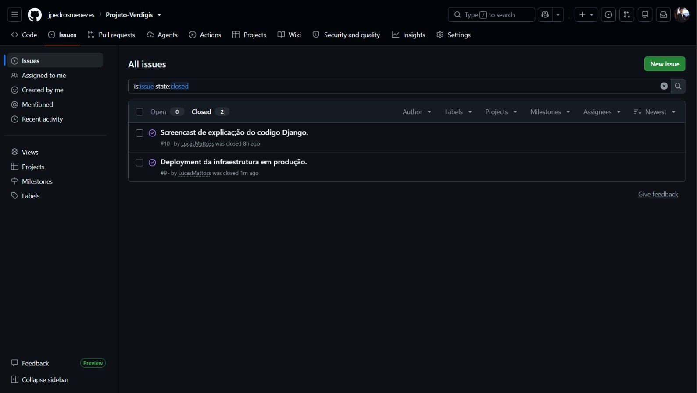
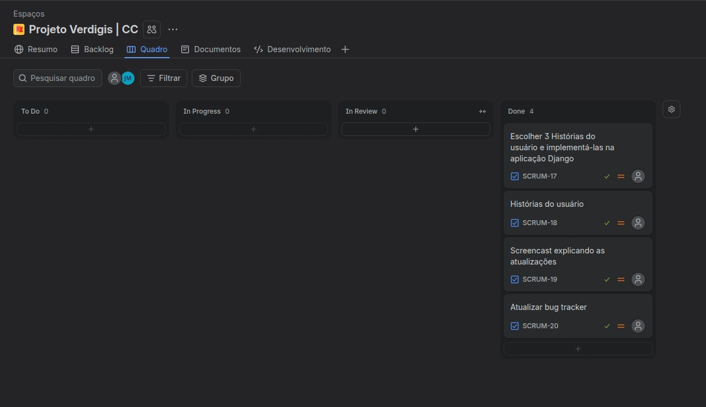
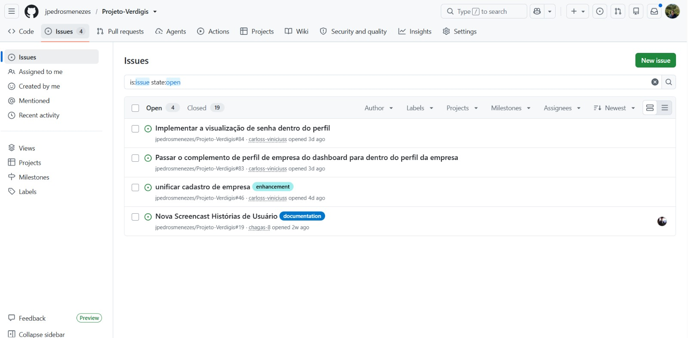

# Entregas do Projeto Verdigis

Repositório: [`Projeto-Verdigis`](https://github.com/jpedrosmenezes/Projeto-Verdigis)

## Índice

- [Entrega 01](#entrega-01)
- [Entrega 02](#entrega-02)
- [Entrega 03](#entrega-03)
- [Entrega 04](#entrega-04)

---

## Entrega 01

### Documentação
- [Benchmark - Análise de Competidores](./competitoranalysis/competitoranalysis.md)

### Backlog

### Quadro do 1º Sprint

---

## Entrega 02

### Quadro do 2º Sprint

### Site
- [Acessar o site](https://projeto-verdigis.onrender.com)

### Screencast de explicação do código Django
- [Assistir no YouTube](https://youtu.be/IaMJn3oHWg4)

### Screencast do Deployment
- [Assistir no YouTube](https://youtu.be/w_VHeL16tqk)

> Legendas disponíveis no YouTube.

### Issue/Bug Tracker

---

## Entrega 03

### Backlog

### Quadro do 3º Sprint

### Site
- [Acessar o site](https://projeto-verdigis.onrender.com)

### Screencast de explicação do código Django
- [Assistir no YouTube](https://youtu.be/lO8UCX8t5BI)

### Screencast do Deployment
- [Assistir no YouTube](https://youtu.be/b2IN5Jz2a6U)

### Histórias Implementadas:

#### *História 01 :*

Como gestor de uma empresa, quero fazer o cadastro dela na plataforma Verdigis, para começar a usar os benefícios que a plataforma traz na questão da ESG, melhorando algumas atividades que são aplicadas ou não na minha empresa.

Critérios de aceitação: 
O gestor da empresa precisa colocar os  dados da empresa.
Além disso, a empresa deve colocar o seu nicho para a plataforma focar naquilo que a empresa precisa.
O sistema deve pedir informações importantes na parte do ESG para ter uma noção do que a empresa aplica.
O sistema avaliará as informações dadas e validar elas.

#### *História 02 :*

Como representante da empresa, quero estabelecer metas de atividades de ESG para minha empresa, buscando trazer objetivos para melhorar algumas partes da empresa, principalmente a questão da sustentabilidade.

Critérios de aceitação:
O usuário deve criar a meta.
Após isso, ele deve relacionar a meta com alguma atividade/área que deseja focar.
Juntamente com isso,  o usuário deve colocar um tempo limite para realizar a atividade que ele colocou.

#### *História 03 :*
Como responsável pela empresa, quero analisar a seção de reclamações/avaliações dos funcionários, buscando trazer um melhor bem-estar com os funcionários da empresa, fortalecendo a questão social.

Critérios de aceitação:
Deve mostrar de forma simplificada quantas mensagens que abordam determinado conteúdo foram enviadas
Filtrar a avaliação dos funcionários, verificando se é algo positivo ou negativo, buscando fazer com que o empresário vá atrás de mudanças.

### Issue/Bug Tracker

---

## Entrega 04

*Em breve.*